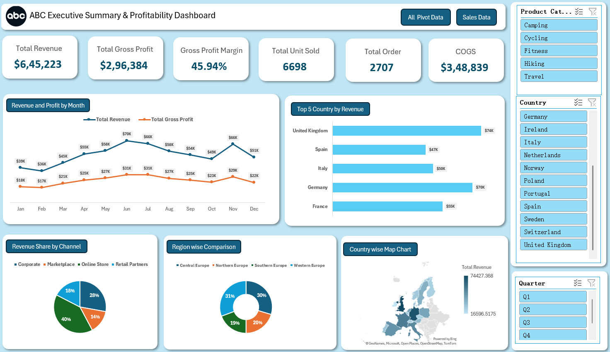

# 📊 Sales & Profitability Dashboard – Excel
## 📌 Project Overview
An interactive Excel dashboard designed to analyse sales performance, revenue, profitability, and regional trends.
## 🛠️ Tools & Skills
- Microsoft Excel
- Pivot Tables & Pivot Charts
- Data Analysis & Data Visualization
- Interactive Slicers
- KPI Development
## 📈 Key KPIs
- Total Revenue: $645,223
- Gross Profit: $296,384
- Gross Profit Margin: 45.94%
- Total Units Sold: 6,698
- Total Orders: 2,707
- COGS: $348,839
## 📊 Dashboard Features
- Monthly Revenue & Profit Analysis
- Top 5 Countries by Revenue
- Sales Channel Analysis
- Region-wise Comparison
- Country-wise Map Chart
- Interactive Slicers
## 🖼️ Dashboard Preview

## 👩‍💻 Author
**Anuradha Kumari**

Aspiring Data Analyst
- LinkedIn:(https://www.linkedin.com/in/anuradha-kumari-bb7918300/)
---
*Created as part of my Data Analytics learning journey.*
